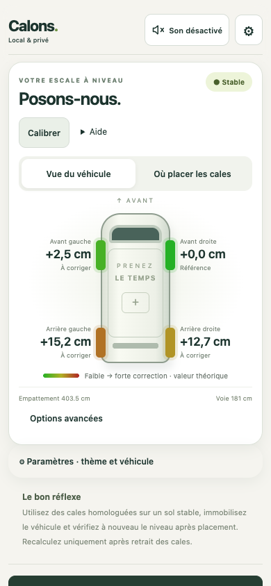
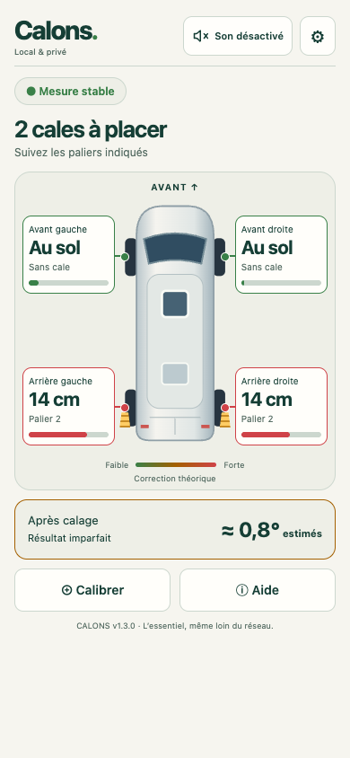
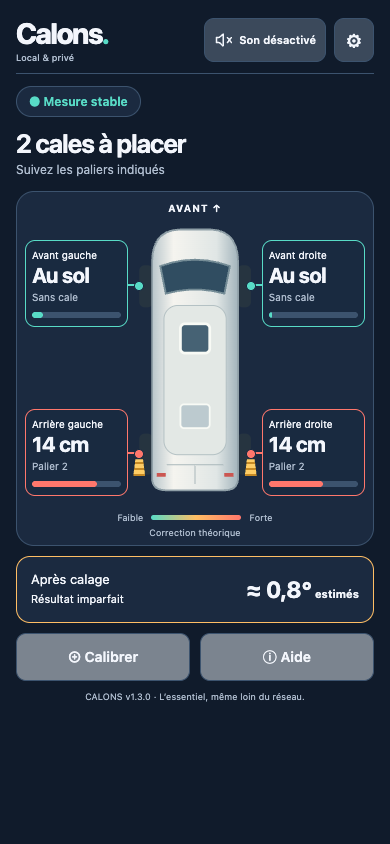
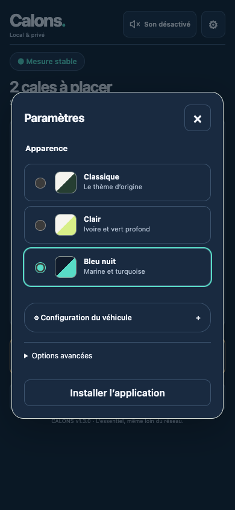
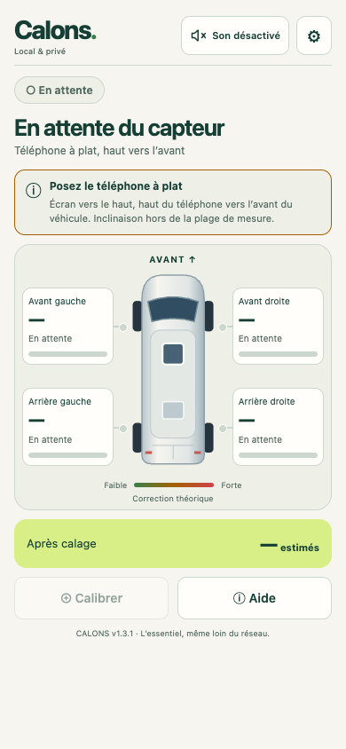

# Calons


PWA React/Vite en français, mobile, sans compte ni serveur applicatif. Les ressources et icônes sont locales : aucun CDN, aucune police distante. Calibration et configuration sont conservées dans le stockage du navigateur.

[Ouvrir Calons](https://cdesaintleger.github.io/calons/) · [Dernière release officielle](https://github.com/cdesaintleger/calons/releases/latest)

## Aperçu de l’application

Trois thèmes au choix dans **⚙ Paramètres → Apparence**, avec une préférence
mémorisée sur votre appareil.

| Classique | Clair | Bleu nuit |
| :---: | :---: | :---: |
|  |  |  |

<details>
<summary>Voir le choix du thème dans les paramètres</summary>



</details>

*Captures de l’interface v1.3.0 au format mobile (390 × 844), réalisées dans
Chrome avec des mesures de capteur simulées. Les jauges représentent la correction
théorique ; les hauteurs et paliers indiquent les cales recommandées.*

## Version 1.3.3 — Jauge de stabilisation

La consigne de placement est remplacée par une jauge lorsque le téléphone est
à plat. Son remplissage dépend des mesures reçues et devient « Stable » après
une acquisition cohérente ; il ne progresse pas artificiellement avec le temps.
Un mouvement relance la stabilisation. Une interruption remet la jauge à zéro,
sans effacer la dernière mesure. « Stable » ne signifie pas « véhicule à niveau ».

Le bandeau conserve sa hauteur dans les trois thèmes pour éviter les sauts de
mise en page. Les problèmes d’accès au capteur restent explicitement indiqués.

## Version 1.3.2 — C comme cale

Nouvelle icône bleu pétrole, C ivoire et cale turquoise : icônes Android/PWA,
écran d’accueil iPhone, onglet du navigateur et en-tête dans les trois thèmes.
La source éditable est `public/logo.svg`. Les PNG sont produits par
`scripts/render-icons.mjs` avec Playwright/Chromium (variables `PLAYWRIGHT_MODULE`
et `CHROME_EXECUTABLE` comme pour les tests visuels).

Le cache inclut tous les formats. Le système peut conserver l’ancienne icône
sur un raccourci déjà installé ; si elle persiste après réouverture en ligne,
recréez le raccourci. Les captures ci-dessus présentent l’interface v1.3.0,
avant ce changement de logo.

## Version 1.3.1 — Aide à la mesure

Dans les trois thèmes, un bandeau explique pourquoi une mesure n’est pas encore
exploitable : téléphone trop incliné, données perturbées ou inutilisables,
stabilisation en cours, absence de signal, pause ou problème d’accès au capteur.
Posez le téléphone **écran vers le haut, son haut vers l’avant du véhicule**,
puis gardez-le immobile. Le bandeau disparaît lorsque la mesure est stable.

Tenir le téléphone en main ne prouve pas un problème d’autorisation. Le diagnostic
utilise les événements effectivement reçus. Sans événement après trois secondes,
l’application suggère de vérifier l’accès aux mouvements du navigateur (Safari
sur iPhone). Une dernière mesure peut rester affichée, explicitement en pause.
Les données rejetées du capteur utilisé ne permettent plus un statut stable ni
un guidage sonore continu ; la réception de données valides reprend la mesure.

Recette sur téléphone : autoriser les capteurs, tenir l’appareil verticalement,
vérifier la consigne, le poser à plat et attendre sa disparition ; vérifier aussi
le refus d’autorisation, une interruption et le retour. Le test automatisé
`scripts/check-guidance.mjs` couvre les trois thèmes sous Chrome et WebKit avec
capteurs simulés (mêmes variables de lancement que `scripts/check-themes.mjs`).

<details>
<summary>Aperçu de la consigne lorsque le téléphone est trop incliné</summary>



*Interface v1.3.1, événement de capteur simulé dans Chrome.*

</details>

## Version 1.3.0 — Thèmes

Ouvrez **⚙ Paramètres → Apparence** pour choisir **Classique**, **Clair** ou
**Bleu nuit**. Le changement est immédiat et le choix reste mémorisé sur cet
appareil, y compris hors ligne. Classique reste le thème par défaut.

Les deux nouvelles vues regroupent le véhicule, les hauteurs des cales, les
paliers et l’inclinaison résiduelle estimée. Les jauges mesurent la **correction
théorique**, sur une même échelle correspondant à la hauteur maximale des cales,
avec saturation au-delà ; elles ne représentent pas les hauteurs discrètes
recommandées. Une roue laissée au sol peut donc avoir une jauge non nulle.
Les valeurs exactes de correction sont disponibles aux technologies d’assistance.
Le choix du thème ne modifie aucun calcul ni calibration. Les outils avancés et
les dimensions se trouvent aussi dans Paramètres. Les écrans principaux compacts
ont été vérifiés sans défilement à 320×740, 390×844 et 430×932 ; paramètres et aide
peuvent défiler, et le contenu reste accessible sur des écrans plus petits ou zoomés.

La suite de régression visuelle `scripts/check-themes.mjs` utilise Playwright
(disponible séparément, avec Chromium et WebKit). Lancer le serveur Vite sur le
port 4174 puis `node scripts/check-themes.mjs`. Variables facultatives :
`PLAYWRIGHT_MODULE` (module Playwright), `CHROME_EXECUTABLE`, `TEST_URL`,
`TEST_OUTPUT` (captures, `/tmp/calons-theme-check` par défaut).

## Version 1.2.1 — guidage audible et écran simplifié

Le bouton **Son activé / Son désactivé** reste accessible dans l'en-tête pendant
le défilement et dans les deux vues. Le son est désactivé au chargement ; un clic
le démarre, un autre le coupe immédiatement. Aucun réglage ni onglet à ouvrir.

Le guidage utilise l'inclinaison combinée des deux axes **réellement mesurés après
calibration**, jamais l'inclinaison résiduelle prédite par le calcul des cales.
Le rythme varie sur toute la plage exploitable : environ un bip toutes les deux
secondes à 15°, puis accélération progressive jusqu'à cinq bips par seconde près
du niveau. Le timbre triangulaire à 880 Hz et le gain renforcé améliorent la présence
du signal (gain 0,30 pour les bips, 0,22 pour le continu). Une mesure
stable à 0,2° ou moins déclenche un son continu ; la sortie de cet état se
fait au-delà de 0,3° ou dès que la stabilité est perdue. Cette hystérésis évite les
bascules dues au bruit. Ces seuils sont une tolérance pratique, pas une garantie
de précision physique.

Le son est suspendu en mode simulation, sans calibration/mesure exploitable,
après trois secondes sans mesure valide ou en arrière-plan. Le son continu possède
aussi une échéance programmée sur l'horloge audio : il ne peut pas rester actif
indéfiniment si les timers JavaScript sont retardés. Le retour au premier plan
demande une mesure fraîche ; si le navigateur interrompt le contexte audio, le
bouton repasse à désactivé et permet de le réactiver d'un geste.

L'audio est créé/repris uniquement lors du clic, conformément aux restrictions
des navigateurs mobiles. Le volume réel dépend du volume multimédia, du mode
silencieux et de la sortie audio du téléphone (Bluetooth compris). Le son est
synthétisé localement par Web Audio, sans téléchargement, et fonctionne hors ligne.
Les capteurs, le zéro mémorisé et l'optimisation des cales restent inchangés.

Recette Android/Chrome et iPhone/Safari : vérifier le bouton à 320 px et après
défilement, activer puis couper le son, approcher progressivement du niveau et
confirmer le son continu après stabilisation, interrompre les capteurs/verrouiller
l'écran, revenir à l'application puis tester en mode avion. Vérifier le volume
multimédia et le comportement d'une éventuelle sortie Bluetooth. Les tests
automatisés ne remplacent pas cette validation acoustique sur téléphones réels.

Référence : [bonnes pratiques Web Audio et activation utilisateur](https://developer.mozilla.org/en-US/docs/Web/API/Web_Audio_API/Best_practices).

L'écran principal affiche le véhicule, les corrections, un statut avec symbole
et libellé (Stable, En mesure, En pause), ainsi qu'un bouton Calibrer compact.
L'aide de placement est dépliée tant qu'aucun zéro n'est mémorisé. Les angles,
Téléphone/Simulation, la source et Relancer le capteur sont dans **Options avancées**.
La réception reste active et reprend dès l'arrivée de nouveaux événements ; aucune
mesure n'est inventée et les permissions initiales exigent toujours un clic.
Calibrer demande confirmation d'une surface horizontale avant de remplacer le zéro.

**Tester le son**, dans Options avancées, joue 0,7 seconde indépendamment des
capteurs puis désactive le son. Il remplace le guidage s'il était actif ; réactivez
ensuite Son pour guider le nivellement. Pour la recette physique, comparez aussi
les cadences à 8°, 3°, 1° puis à plat, et contrôlez la coupure du test et du guidage.

## Utiliser / construire

Node.js 22.12+ (v1.1.5 validée localement avec Node 24.19.0 ; workflow sous Node 22).

```sh
npm ci
npm test
npm run build
npm run preview
```

Le dossier `dist/` est la livraison statique complète. Ne pas ouvrir `index.html` par `file://`. Le service worker est généré après chaque build, avec une version calculée sur le contenu de tous les fichiers. Le serveur de développement n’active pas le cache PWA.

## GitHub Pages

Adresse : https://cdesaintleger.github.io/calons/

Le dépôt est public et GitHub Pages est activé avec HTTPS obligatoire.

Le workflow `.github/workflows/pages.yml` installe les dépendances avec `npm ci`,
construit la PWA et exécute les tests avant de publier `dist/`.
Chaque push sur `main` déploie automatiquement ; les pull requests lancent uniquement
les vérifications. Un lancement manuel est possible depuis Actions → Deploy to GitHub Pages.

Dans Settings → Pages, la source doit être **GitHub Actions**.
Le job de déploiement dispose uniquement des permissions Pages et OpenID Connect
nécessaires ; aucun secret personnel n'est requis.

Le workflow définit `VITE_BASE_PATH=/calons/`. Pour reproduire ce build localement :

```sh
VITE_BASE_PATH=/calons/ npm test
VITE_BASE_PATH=/calons/ npm run preview
# Ouvrir http://localhost:4173/calons/
```

Le manifest conserve des URLs relatives et le service worker est enregistré sous
`/calons/sw.js`. Ses caches sont isolés par URL de portée pour ne pas supprimer
ceux d'une autre installation sur le même domaine GitHub Pages.
Pour un futur domaine personnalisé à la racine, remplacer `VITE_BASE_PATH` par `/`.

Pour revenir à une version précédente, rétablir son code dans un nouveau commit
sur `main` : le même workflow republiera cette version. Les installations PWA
adopteront la mise à jour après fermeture des anciens onglets puis réouverture en ligne.

## Déploiement HTTPS

Publier **le contenu de `dist/`** sur votre hébergement statique HTTPS. Le ZIP `ducato-level-dist.zip` contient exactement ce contenu. Le chemin de base est relatif : la PWA peut être publiée à la racine ou dans un sous-dossier, avec une URL terminée par `/`.

Exemple de configuration Netlify fourni dans `netlify.toml` (commande `npm run build`, dossier `dist`). Il n’est pas nécessaire d’utiliser Netlify : tout serveur statique HTTPS convient. Le déploiement GitHub Pages est géré par le workflow décrit ci-dessus.

Pour un serveur Caddy existant : adapter le domaine et le chemin du `Caddyfile.example`, faire pointer le DNS vers ce serveur et ouvrir les ports 80/443. Caddy peut obtenir le certificat automatiquement. Ne pas servir `sw.js` avec un cache HTTP de longue durée ; conserver le type JavaScript. Servir le manifest en `application/manifest+json` ou `application/json`.

HTTPS est nécessaire sur téléphone pour les capteurs et le service worker ; `localhost` bénéficie d’une exception de développement. Un téléphone accédant à l’adresse IP HTTP du PC ne bénéficie pas de cette exception.

## Installation et hors connexion

1. Ouvrir l’URL HTTPS en ligne et attendre « Prêt hors ligne ».
2. Android/Chrome : utiliser « Installer l’application » ou le menu du navigateur.
3. iPhone/Safari : Partager → Sur l’écran d’accueil.
4. Ouvrir l’application installée, activer le mode avion et recharger pour vérifier le cache sur l’appareil cible.

Une mise à jour se prépare en arrière-plan et s’active après fermeture des anciens onglets de l’application. Rouvrir ensuite l’application. Le navigateur peut supprimer son stockage en cas de manque d’espace ; ouvrir alors une fois en ligne. Le badge de connexion dépend du signal fourni par le navigateur et ne teste pas l’accès Internet.

## Interface

Les commandes de mesure sont accessibles dès le premier écran. Les onglets « Vue du véhicule » et « Où placer les cales » partagent la même mesure. Le schéma affiche les corrections théoriques à 0,1 cm près, sans prétendre à cette précision physique. Les roues passent du vert (0 cm) au rouge (hauteur maximale des cales), sur une échelle identique pour les quatre roues. Le placement reste optimisé pour deux cales à paliers de 7 cm ; sa hauteur réalisable est distincte de la correction théorique.

## Mesure et calibration

- Renseigner l’empattement (distance entre essieux) et la voie (distance entre centres des roues). Les valeurs initiales 403,5 / 181 cm sont des exemples, pas une certification des dimensions de votre Ducato. Le modèle suppose une voie identique à l’avant et à l’arrière.
- Renseigner le nombre de paliers réellement disponibles (1 à 5), tous de 7 cm.
- Calibrer sur une référence **connue horizontale**, téléphone immobile, écran vers le haut, portrait naturel, haut du téléphone vers l’avant du véhicule. Ne pas calibrer sur le plancher incliné du fourgon.
- Replacer ensuite le téléphone dans la même orientation. Le zéro corrige l’orientation par rotation du vecteur vertical (et non simple soustraction d’angles couplés).
- L’accès aux capteurs est demandé uniquement au clic. Les mesures sont filtrées ; après 3 secondes sans événement valide, la valeur reste visible avec le statut « Dernière mesure conservée · non actualisée ». Les appareils retournés ou trop inclinés sont rejetés.
- Prendre la mesure véhicule arrêté **sans cales**. Après pose, lire l’inclinaison pour vérifier, sans appliquer une nouvelle recommandation à des cales déjà présentes.

## Calcul et limites

Les hauteurs initiales sont calculées par `z = x tan(roulis) + y tan(tangage)`, avec coordonnées des centres des roues en cm. Les corrections théoriques continues sont `max(z) - z` ; elles sont distinctes des hauteurs réalisables avec deux cales.

Toutes les combinaisons de zéro, une ou deux roues relevées de 7 × palier cm sont examinées. Une caisse rigide avec quatre supports non coplanaires ne possède pas de plan unique : chaque triangle de support dont le plan est au-dessus du quatrième appui est évalué. Le score est la plus grande inclinaison de ces plans, `atan(hypot(pente_x, pente_y))`. Le minimum global est retenu ; égalités départagées par nombre de cales, puis somme des hauteurs, puis ordre d’énumération fixe.

C’est une optimisation prudente **dans ce modèle**, pas une garantie de niveau réel. Elle suppose un terrain localement plan, une géométrie rectangulaire et un centre de masse suffisamment central ; elle ne modélise pas suspension, pression des pneus, enfoncement du sol ni déplacement du véhicule en montant sur la cale. Une seule recommandation est affichée, avec l’inclinaison résiduelle estimée. Une inclinaison résiduelle supérieure à 0,5° déclenche une indication de résultat imparfait (seuil d’interface, pas une tolérance constructeur).

## Vérifications réalisées

- Tests automatisés : géométrie et optimisation des cales, calibration, capteurs simulés, permissions, interruptions, stabilité, cache hors réseau, renouvellement des caches et chemins GitHub Pages. Voir les notes de release pour la validation de chaque version.
- Build de production React/Vite réussi.
- Vérification visuelle Chrome bureau et largeur mobile 390 px ; simulation et proposition d’installation visibles.
- Cache hors ligne contrôlé avec arrêt du serveur de preview puis rechargement navigateur.

À valider sur les appareils réels : autorisations et précision des capteurs iOS/Android, installation depuis le domaine HTTPS final, répétabilité du zéro et mesures physiques du véhicule. Aucun téléphone ni fourgon réel n’a été utilisé pour cette validation.

Références : [convention W3C des angles](https://www.w3.org/TR/orientation-event/), [permission des capteurs](https://developer.mozilla.org/en-US/docs/Web/API/DeviceOrientationEvent/requestPermission_static), [déploiement Vite](https://vite.dev/guide/static-deploy.html).

## Version 1.1.0 et retour arrière

Les releases GitHub sont identifiées par un tag `vMAJEUR.MINEUR.CORRECTIF`.
Pour revenir à une version publiée : Actions → Deploy to GitHub Pages → Run workflow,
laisser la branche `main` et renseigner le tag (par exemple `v1.0.0`) dans `version`.
Le workflow reconstruit et vérifie cette version avant de la publier. Un push ultérieur
sur main publiera à nouveau main. Les installations hors ligne restent sur leur version
jusqu'à reconnexion et fermeture des anciens onglets.

Les cales peuvent avoir 1 à 5 paliers de hauteurs totales personnalisées, strictement
croissantes, jusqu'à 50 cm. Les anciens réglages sont conservés avec leurs paliers de 7 cm.
La stabilité demande au moins 10 mesures sur 1,5 seconde, récentes de moins d'une seconde,
avec une amplitude de 0,2° maximum sur chaque axe dans une fenêtre de deux secondes.
Ce critère mesure l'immobilité, pas la précision absolue. La calibration est désactivée
pendant les mouvements ; le placement reste affiché comme provisoire.

## Version 1.1.1

Le numéro affiché dans l’en-tête provient de package.json. Chaque événement capteur
est affiché directement : le filtre récursif qui conservait une ancienne inclinaison
quand les événements s’arrêtaient a été supprimé. Sans nouvel événement, la dernière
mesure reste visible et est signalée comme ancienne après trois secondes. Cela
ne permet pas de distinguer un téléphone immobile d’un capteur interrompu.
Les critères de stabilité et la fraîcheur requise pour calibrer restent appliqués.

## Version 1.1.3

Relancer le capteur réinstalle son écoute et efface les anciennes mesures. Un changement
de visibilité invalide aussi les mesures en mémoire. Une mesure conservée sans nouvel
événement est signalée comme telle. La calibration reste possible après confirmation
explicite de l’horizontalité et de l’immobilité si la stabilité n’est pas confirmée.
Aucune calibration n’est possible avant le premier événement valide de la session.

## Version 1.1.5 — capteurs et fraîcheur

Le diagnostic du code 1.1.4 montre que le délai de trois secondes ne désactive pas
le capteur : il dégrade son statut. Le critère de stabilité expirait dès une seconde
de silence, tandis qu'une valeur invalide ou un changement de visibilité effaçait
la mesure. Les événements étaient affichés directement, sans filtre. Le code seul
ne permet pas d'établir pourquoi un téléphone particulier cesse d'émettre.

Le module `src/sensors.js` sélectionne une seule source : `devicemotion` est préféré
après au moins cinq événements valides répartis sur 500 ms, sans intervalle de plus
de 250 ms. `deviceorientation` prend le relais sur son prochain événement valide
si motion est silencieux/inexploitable depuis une seconde. Revenir à motion exige
à nouveau sa qualification. Aucune API ne garantit un flux permanent.

Le vecteur `accelerationIncludingGravity` doit avoir des composantes finies, une
norme entre 8,5 et 11 m/s² et un axe z positif. Une accélération linéaire disponible
supérieure à 0,5 m/s² est rejetée. Les angles respectent exactement la convention
existante ; un écart supérieur à 0,3° avec une orientation récente rejette motion.
Les implémentations aux conventions incompatibles gardent donc le repli orientation.
Un mouvement à norme proche de g reste difficile à distinguer de la gravité seule :
la mesure s'utilise exclusivement véhicule arrêté.

Un filtre exponentiel de constante 150 ms et une bande morte de 0,03° limitent le
bruit. La pose stabilisée est conservée jusqu'à un écart réel supérieur à 0,08°.
La confirmation initiale utilise toujours au moins dix événements sur 1,5 seconde
dans une fenêtre de deux secondes, amplitude maximale de 0,2° par axe. Une interruption
ou un changement de source impose une nouvelle confirmation. « Active », « stable »
et « dernière mesure non actualisée » sont des états distincts ; le timer ne fait
que mettre à jour le statut, jamais les mesures. La dernière pose stabilisée est
aussi conservée séparément dans le contrôleur.

En arrière-plan, les valeurs restent visibles mais sont invalidées comme données
actuelles. Le retour au premier plan exige un nouvel événement. Les permissions
motion/orientation sont demandées lors du même clic, avant toute attente asynchrone ;
le refus d'une source n'empêche pas l'autre de fonctionner. Sans événements, la
simulation reste disponible. Le zéro `ducato-cal` conserve sa clé, son format et sa
rotation mathématique, sans migration ni recalibration silencieuse.

Le cache PWA reste fondé sur le contenu du build : le nouveau JavaScript, incluant
la version 1.1.5, produit une nouvelle clé. Fermer tous les onglets/PWA de Calons
puis rouvrir en ligne permet l'activation de la mise à jour ; les autres caches
du domaine ne sont pas supprimés.

### Recette restant à faire sur Android/Chrome et iPhone/Safari

1. Ouvrir l'URL HTTPS puis la PWA installée ; vérifier v1.1.5 et les réglages/zéro
   déjà mémorisés. Activer les capteurs, tester acceptation et refus des permissions.
2. Sur une référence horizontale connue, écran vers le haut, haut vers l'avant,
   calibrer si nécessaire ; rester immobile 30 secondes et observer le statut.
3. Incliner légèrement vers chacun des quatre côtés : vérifier avant/arrière et
   droite/gauche, réaction rapide puis stabilisation, sans oscillations permanentes.
4. Mettre en arrière-plan ou verrouiller le téléphone plus de trois secondes :
   vérifier la conservation de la valeur et l'état non actualisé au retour, puis
   la reprise et une nouvelle confirmation de stabilité après un petit mouvement.
5. Si motion n'est pas disponible, vérifier le repli orientation. Si les deux flux
   s'arrêtent, la valeur doit rester affichée sans prétendre être actualisée.
6. Fermer les anciennes fenêtres, rouvrir en ligne puis tester le mode avion :
   affichage, réglages, simulation et calcul des cales doivent rester disponibles.

Validation automatisée uniquement pour les capteurs de cette release : aucun test
physique Android/iPhone ni contrôle de précision sur véhicule n'est revendiqué.
Références : [axes et événements W3C](https://www.w3.org/TR/orientation-event/),
[gravité et limites de l'accéléromètre](https://developer.mozilla.org/en-US/docs/Web/API/DeviceMotionEvent/accelerationIncludingGravity).
